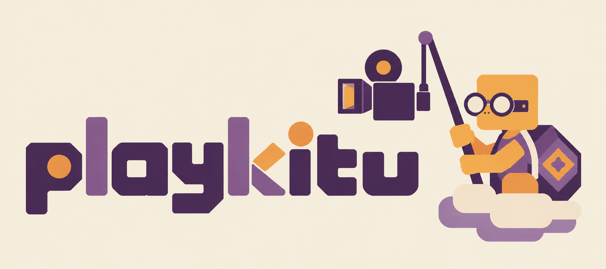

<strong>Gameplay, game audio, optional voice, and the logs that explain what happened.</strong>

<strong>Free and open source</strong> · Unity · Windows 64-bit (x86-64) only (as of right now) · Steam

playkitu helps developers see their game through a playtester's eyes. Players consent and play. Recordings stream while the game runs, and matching diagnostic logs give developers context for improving the game.

**Free and open source:** the original project code is [MIT licensed](LICENSE). There is no playkitu subscription or software fee. You deploy the backend in your own AWS account and pay its infrastructure and usage costs.

**Contributions welcome!** Help make playkitu useful for more developers: bug fixes, documentation, examples, testing and support for more platforms are all welcome. [Get involved](CONTRIBUTING.md).

**Current recording support: Windows 64-bit (x86-64) only.** The Unity recording client and native runtime currently support this platform. macOS, Linux, 32-bit Windows and native ARM64 players are not supported yet; contributions toward broader platform support are welcome. This platform restriction applies to the recording client; the supplied backend runs on AWS.

**Experimental, source-first release.** Independent Unity import, lifecycle, native, backend, download and infrastructure checks pass. A small Windows IL2CPP sample also passes native loading and cleanup. A freshly deployed end-to-end installation and clean-machine support remain release checks. Prebuilt native binaries are not distributed here.

[Try the sample](#try-it-locally) · [Integrate Unity](docs/unity-integration.md) · [Deploy AWS](infra/README.md) · [Download recordings](tools/download/README.md) · [Development](docs/development.md)

## What you get

- **Game-view recording:** gameplay, menus, UI, a software cursor and game audio.
- **Optional commentary:** separate microphone consent and an immediate Microphone Off control.
- **Continuous upload:** retain footage already uploaded if the game later quits or crashes.
- **Matching diagnostics:** bounded logs and timing metadata for locating relevant footage.
- **Your own backend:** Terraform, Steam verification, private storage and operational controls.
- **A removable package:** game-specific menus, authentication ownership and lifecycle stay in your adapter.

Testers need no recording account, invitation code, external recorder or end-of-session upload step. Developers deploy and operate the backend.

## Try it locally

Open **samples/MinimalUnity** in **Unity 2022.3.62f3**. Open **Assets/OfflineConsent.unity** and enter Play Mode. Check consent, run the local lifecycle check, then stop and remove the recorder.

~~~powershell
git clone https://github.com/jacklaplante/playkitu.git
cd playkitu
~~~

This exercises the real host/controller with an offline, disabled issuer. **It does not record, open a microphone, request Steam tickets or contact AWS.**

For native encoding/decoding with generated video and tone:

~~~powershell
pwsh -NoProfile -File native/prepare.ps1
pwsh -NoProfile -File native/build-credentials.ps1
pwsh -NoProfile -File native/test.ps1 -GeneratedMedia
~~~

This needs Windows x64, PowerShell 7, Git and Visual Studio C++/Windows SDK tools. Downloads are pinned and verified; installers are extracted rather than run. See [native prerequisites](native/README.md) and the [small IL2CPP self-check](docs/development.md#small-windows-il2cpp-check).

## Use it in a game

1. [Build the native runtime](native/README.md) and [deploy the backend](infra/README.md) in your own AWS account. Recording starts **OFF**.
2. Install **com.playkitu.recording** with Unity Package Manager using the Git URL below. For local development, select **packages/com.playkitu.recording/package.json** using Add package from disk.
3. Supply trusted deployment settings, an existing Steam ticket owner and a packaged native runtime path.
4. Connect your consent UI and lifecycle to **PlaykituRecorder**. Keep microphone consent separate; allow gameplay to continue if recording fails after required consent.
5. Run a consented integration test, then retrieve its video and logs with the [download tool](tools/download/README.md).

The [Unity guide](docs/unity-integration.md) covers the API, Steamworks.NET example, build inclusion and removal. The [AWS guide](infra/README.md) covers roles, key setup, OFF controls, alerts and state. Cloning or importing this repository does not provision or activate AWS.

~~~text
https://github.com/jacklaplante/playkitu.git?path=/packages/com.playkitu.recording#v0.2.0
~~~

## How it works

Upgrading from playreel? See the [rename and compatibility notes](docs/renaming.md).

~~~mermaid
flowchart LR
    Consent[Player consents] --> Unity[Unity package]
    Unity --> API[HTTPS authorization API]
    API --> Steam[Steam ticket and app ownership]
    API --> Grant[Short-lived session access]
    Grant --> Unity
    Unity --> Video[Private Kinesis Video Streams]
    Unity --> Logs[Private S3 logs and timing]
    Video --> Tool[Developer download tool]
    Logs --> Tool
~~~

GStreamer, Windows Media Foundation and AWS's producer SDK provide the native media path. Publisher keys stay on the backend; AWS developer credentials do not belong in a game build.

## Compatibility and expectations

| Area | Initial scope |
| --- | --- |
| Unity | 2022.3.62f3 baseline; other versions need validation |
| Player | Windows 64-bit (x86-64) only; IL2CPP native-load self-check demonstrated |
| Authentication | Steam tickets and app ownership |
| Deployment | One configured app/account/region per AWS deployment |
| Sessions | Up to four hours, followed by bounded diagnostic finalization |
| Cloud retention | 30 days in the supplied deployment |
| Other platforms/clouds | Outside current support; contributions welcome |

Gameplay takes priority. Recording can drop media under load. Exact final frames, lossless recovery and continuous coverage are not guaranteed. Log navigation reports uncertainty or unavailable media instead of inventing a match.

## Consent, data and costs

Capture is limited to the game view, game audio, an explicitly enabled microphone, and redacted current-session logs. Microphone Off stops listening and clears unmixed samples; already-mixed consented audio may finish uploading. Review your logging: redaction cannot guarantee arbitrary logs contain no sensitive information.

AWS infrastructure, storage, traffic and retrieval incur charges in **your** account. Conservative quotas and spending/error alerts are supplied. Alerts are delayed notifications, not hard billing caps. See [costs and controls](infra/README.md#fixed-architecture-and-limits).

Uninstalling client code does not delete retained recordings or paid infrastructure. [Removal instructions](docs/unity-integration.md#removing-playkitu) distinguish those operations.

## Repository

| Location | Contents |
| --- | --- |
| packages/com.playkitu.recording | Unity capture, lifecycle, uploads and tests |
| native | Native source, SDK patches, pinned build tooling and tests |
| backend/issuer | Steam verification and scoped authorization |
| infra | Terraform, owner policies, controls and offline validation |
| tools/download | Private retrieval, offline inspection and log navigation |
| samples/MinimalUnity | Independent sample and opt-in native self-check |
| tests/fixtures | Shared synthetic/timing fixtures and provenance |

## Contributing and licensing

**Issues and pull requests are welcome.** Whether you're fixing a bug, improving a guide, sharing an integration example or helping bring recording to another platform, we'd love your help. Small improvements count too. See [CONTRIBUTING.md](CONTRIBUTING.md) to get started and [SECURITY.md](SECURITY.md) for reporting vulnerabilities privately.

Original project code is **[MIT licensed](LICENSE)**. Dependencies retain their own terms. Native binary distribution needs corresponding-source, notices, replacement-right and redistribution work beyond this license. Read [third-party notices](THIRD_PARTY_NOTICES.md) and [native redistribution status](native/REDISTRIBUTION.md).
